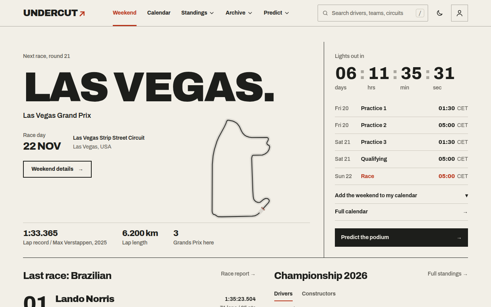
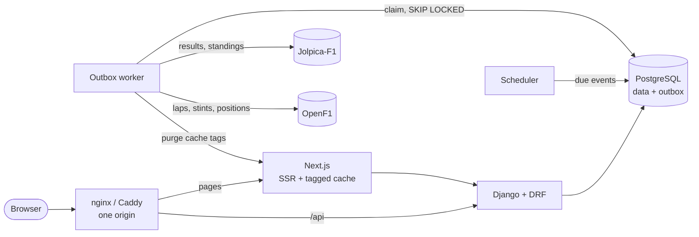
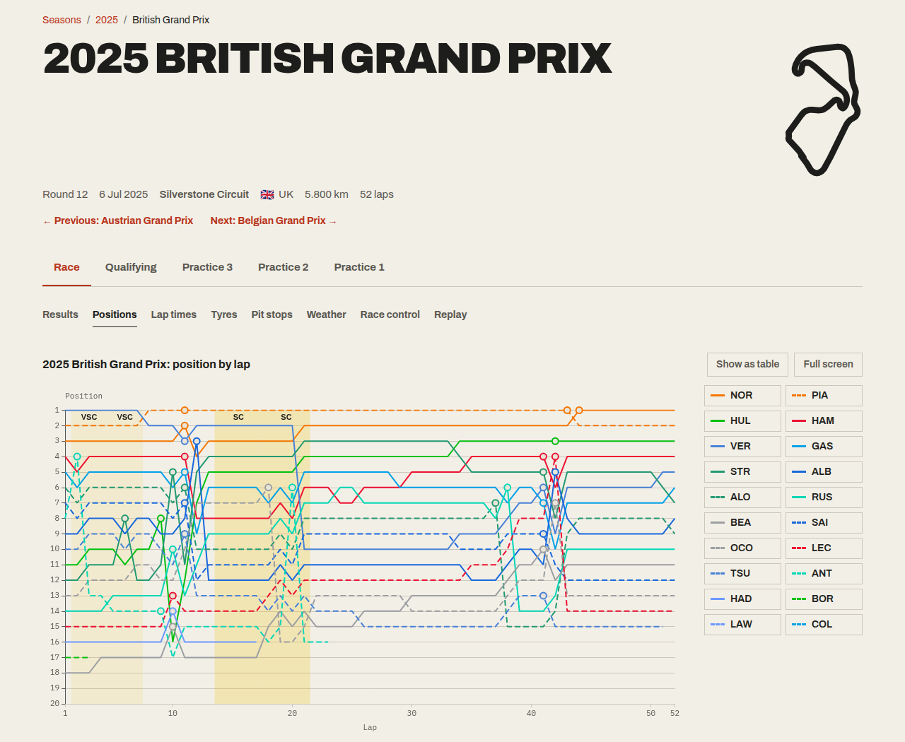
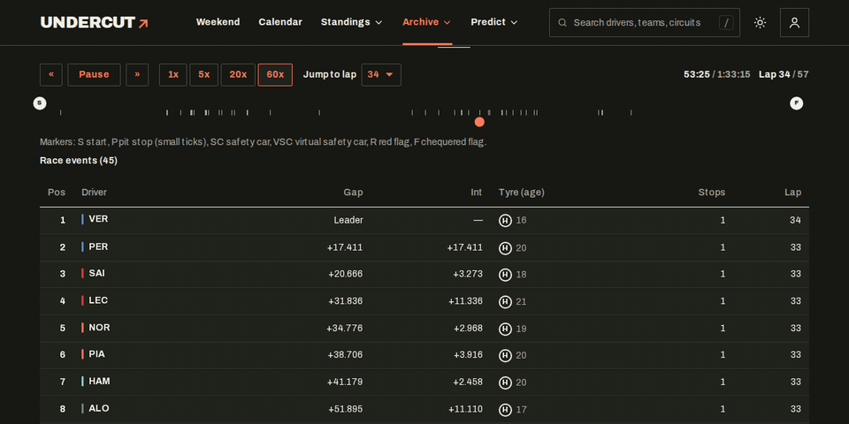

# Undercut

[](https://github.com/MaciejZiel/undercut/actions/workflows/ci.yml)
[](https://github.com/MaciejZiel/undercut/actions/workflows/e2e.yml)
[](https://github.com/MaciejZiel/undercut/actions/workflows/audit.yml)

**Formula 1 since 1950: stats, lap-by-lap race analysis, race replay and a podium prediction
game.** A Django modular monolith with an event-driven pipeline (PostgreSQL transactional
outbox, no broker) and a Next.js frontend, self-hosted and updating itself after every session.

**Live: <https://undercut.maciejzielinski.dev>** ("Try the demo without registering" on the login page)



## What is worth a look (for engineers)

| | Where |
|---|---|
| Modules that cannot import each other's models, enforced in CI by import-linter | [`pyproject.toml`](backend/pyproject.toml), [architecture](docs/architecture.md) |
| Transactional outbox: events written in the same transaction as the data, per-handler delivery and retries, `SKIP LOCKED` worker, idempotent handlers | [`apps/events`](backend/apps/events), [ADR 003](docs/adr/003-transactional-outbox.md), [event catalog](docs/events.md) |
| Exactly-once post-race e-mail on top of at-least-once delivery | [`notifications/handlers.py`](backend/apps/notifications/handlers.py) |
| Predictions locked server-side at qualifying start, scoring as a pure function, recomputed after corrections | [`apps/predictions`](backend/apps/predictions) |
| ~930 backend tests on real PostgreSQL, 90% coverage gate, query-count tests and an N+1 gate (pytest-queryguard) | [testing](docs/testing.md), [N+1 write-up](docs/n-plus-one.md) |
| Load test per endpoint in GitHub Actions against the Compose stack, p50/p95/p99 published | [performance](docs/performance.md), [`perf.yml`](.github/workflows/perf.yml) |
| Playwright end-to-end tests against the full Docker Compose stack in GitHub Actions | [`e2e/`](e2e), [`e2e.yml`](.github/workflows/e2e.yml) |
| Type check with zero pyright errors (annotated ORM shapes instead of ignores), weekly dependency audit | [`pyrightconfig.json`](backend/pyrightconfig.json), [`audit.yml`](.github/workflows/audit.yml) |
| Operations: health and readiness, pipeline alerts, JSON logs with request ids, backups with a restore test | [operations](docs/operations.md) |

## Architecture



One Django code base runs as three processes (API, outbox worker, scheduler). Modules
(`catalog`, `ingestion`, `standings`, `analytics`, `accounts`, `predictions`, `notifications`,
`webcache`) talk only through small public interfaces and events. After a race the chain is:
scheduler publishes `SessionResultsDue` → ingestion fetches results and publishes
`SessionResultsFinalized` in the same transaction → standings, prediction scoring, the post-race
e-mail and precise frontend cache purges follow. Details: [docs/architecture.md](docs/architecture.md),
decisions: [docs/adr](docs/adr).

| Layer | Choice |
|---|---|
| Backend | Python 3.13, Django 6, DRF, drf-spectacular (OpenAPI), django-allauth headless (sessions) |
| Frontend | Next.js (App Router), TypeScript, Tailwind, TanStack Query, ECharts |
| Data | PostgreSQL 16+ only (unaccent, trigram, JSONB, `SKIP LOCKED`) |
| Quality | pytest + factory_boy, pytest-queryguard, import-linter, ruff, pyright, Vitest, Playwright, GitHub Actions |

## Features

- **Catalog and history:** every season since 1950, rounds, circuits, drivers, constructors and
  results, with the constructor recorded on race day. Championship tables per round, points
  progression, title statistics, head to head.
- **Race analysis (2023 onwards):** lap-by-lap positions, lap times with slow-lap filtering, tyre
  strategy, pit stops, weather and race control messages.
- **Replay:** play a race back from stored data with a timeline and event markers.
- **Accounts and predictions:** e-mail sign-in (Google optional), favourites, podium predictions locked at
  qualifying start, automatic scoring, global and private league leaderboards, post-race e-mail.
- **Self-updating:** results, standings and corrections are synced after every session.





<sub>The replay GIF is recorded by Playwright against the Docker Compose stack in GitHub Actions ([`capture.yml`](.github/workflows/capture.yml)).</sub>

## Run it

```bash
cp .env.example .env
make up            # everything in Docker, http://localhost:8080
```

Development with hot reload (needs `uv` and Node 24):

```bash
make db            # PostgreSQL and Redis only
make backend-dev   # API on :8000
make frontend-dev  # Next.js on :3000
```

Load the real history (about 30 seconds, free Jolpica dump, no account needed):

```bash
cd backend
uv run python manage.py migrate
uv run python manage.py import_history --download
```

Tests and checks (backend tests need PostgreSQL, e.g. from `make db`):

```bash
cd backend && uv run pytest tests/catalog -q
make lint && make typecheck
cd frontend && npm test
```

## Data sources and attribution

Results and standings: [Jolpica-F1](https://github.com/jolpica/jolpica-f1) (CC BY-NC-SA 4.0).
Lap, stint, pit stop, position and weather data: [OpenF1](https://openf1.org). Both are
community projects used here for non-commercial purposes; any derived data dump must keep the
same terms. No official logos or driver photos are used. Unofficial fan project, not affiliated
with Formula One Group or the FIA. No ads, no payments.

## Self-hosting

Production runs on a self-hosted home server without Docker: PostgreSQL, gunicorn, the outbox
worker, the scheduler and the Next.js server as plain processes under restart loops, behind
nginx and a Cloudflare Tunnel. Start scripts, an env example, nginx snippets and a
deploy/update/rollback runbook are in [deploy/termux/](deploy/termux/README.md).

## Project status

Feature-complete for a season of use; see [docs/PLAN.md](docs/PLAN.md) for the plan and status,
and [docs/audit-2026-11.md](docs/audit-2026-11.md) for the latest self-review and what is next.
