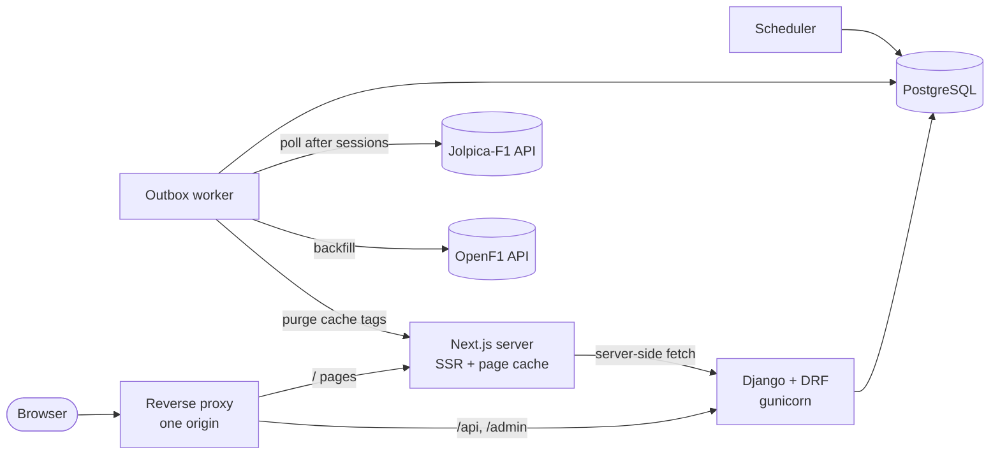
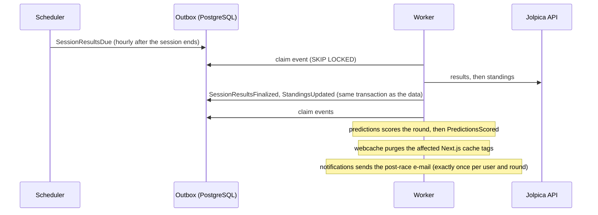

# Architecture

Undercut is a **modular monolith**: one Django application split into modules with explicit
boundaries, which talk to each other through public functions and **events**, never through
each other's models. Import rules are enforced in CI (`import-linter`).

## Containers

`api`, `worker` and `scheduler` run the same code base; they differ only in the command they
start (`gunicorn`, `run_outbox_worker`, `run_scheduler`).

## Modules

| Module | Owns | Talks to others through |
|---|---|---|
| `catalog` | seasons, rounds, sessions, drivers, constructors, results, public read API | `selectors`, `lookups`, `references`, `scheduling` |
| `ingestion` | Jolpica dump and API import, OpenF1 import, `SyncRun`, driver number map | calls other modules' `services`; publishes events |
| `standings` | championship tables per round, progression series | `services`, `selectors` |
| `analytics` | laps, stints, pit stops, position and interval samples, replay | `selectors`, replay API |
| `accounts` | users, favourites, export, deletion, demo user (allauth headless, sessions) | export-provider registry, `user_deleted` event |
| `predictions` | picks, scoring, leaderboards, private leagues | scores on `SessionResultsFinalized` |
| `notifications` | e-mail preferences, one-click unsubscribe, post-race e-mail | reacts to `PredictionsScored` |
| `webcache` | purges the frontend page cache | reacts to data events |
| `events` | transactional outbox, worker, scheduler | the only shared infrastructure |

## Event flow after a race

Every event is written **in the same transaction as the data change** that caused it, so a
fact is never recorded without its event, or the other way round. Delivery is at-least-once
and tracked **per handler**: a retry re-runs only the handlers that failed, and every handler
is idempotent ("recompute for this session", never "apply this delta"). See
[events.md](events.md) for the catalog and [ADR 003](adr/003-transactional-outbox.md).

## Data

- History from 1950 comes from the free Jolpica CSV dump (about 30 s for the whole history),
  current results from the Jolpica API (rate-limited client, 80% of the published limits).
- Race analytics from 2023 come from OpenF1 (laps, stints, pit stops, positions, intervals,
  weather, race control), stored in milliseconds in plain PostgreSQL tables.
- Championship tables are **imported, not recomputed**: history has rules a points table cannot
  express (dropped scores, shared drives, exclusions). Our own computation is only used for
  validation and for the title-chances calculator.
- A result stores the constructor **on race day**, so a driver transfer never rewrites history.

## Frontend caching

Catalog pages are rendered on the server and cached with tags (`drivers`, `season:2024`,
`round:2024-5`, ...). The `webcache` handler purges exactly the tags a data change affects via
`POST /_internal/revalidate` (shared secret, not exposed publicly). Per-user pages (account,
predictions) are never cached and are fetched client-side.
